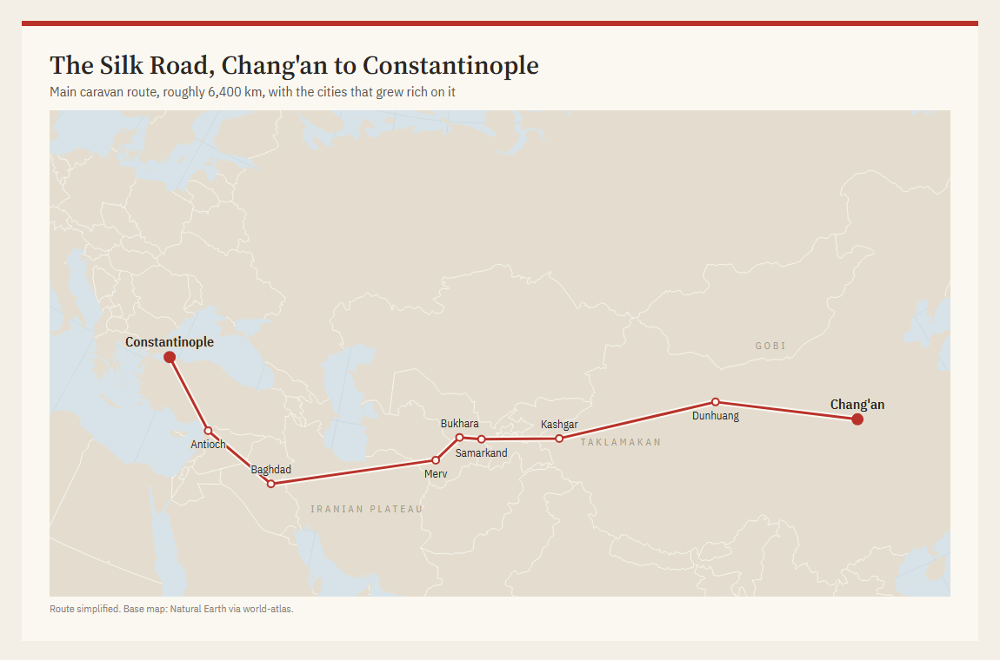
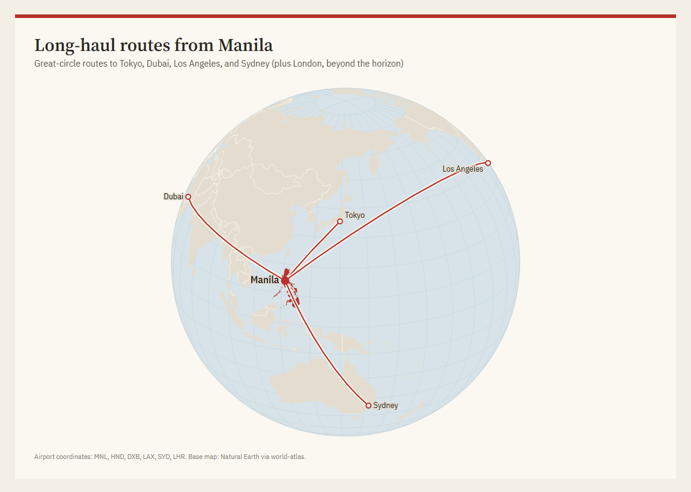
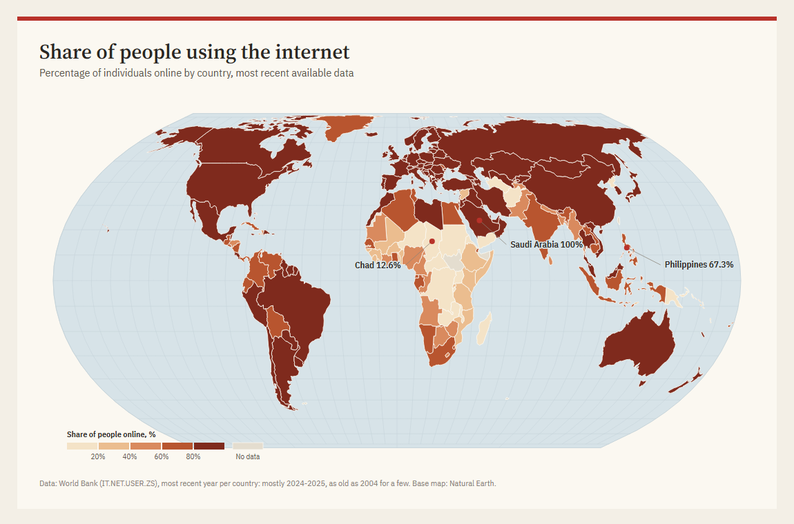
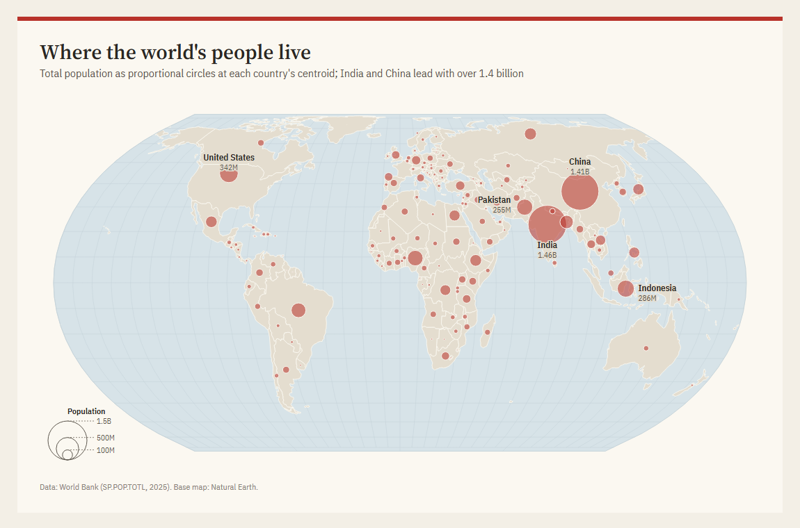
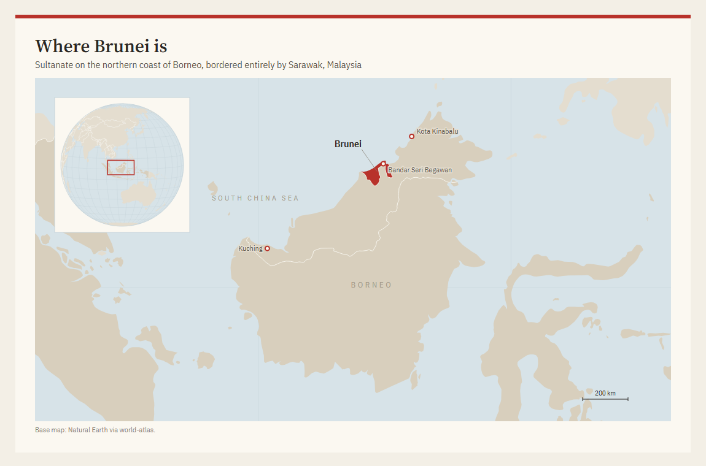
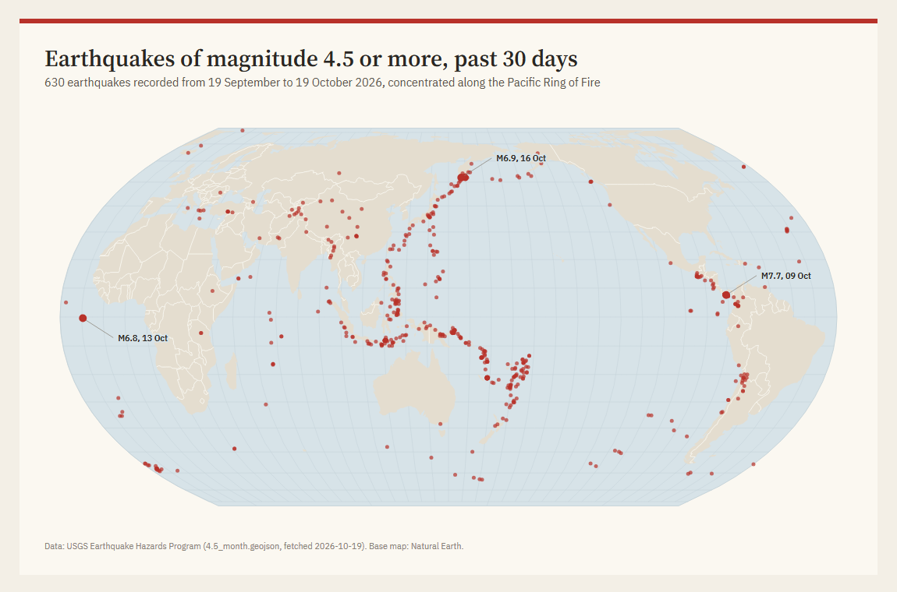
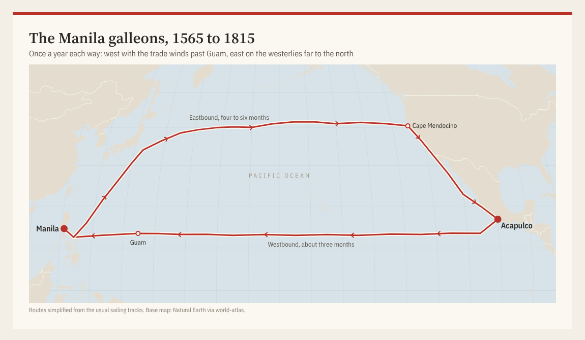
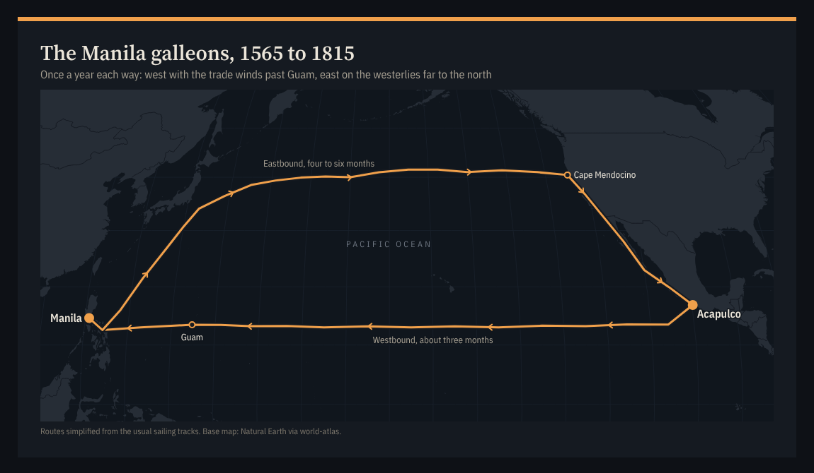

# map-design

[](https://ko-fi.com/jju1s)

An agent skill for Claude Code, Codex and other agents that makes maps in the style of a newspaper graphics desk. Ask for "a map of internet use by country" and you get a single HTML file with an SVG map, real data inlined with its source, light and dark themes, and a PNG.

| | |
|---|---|
|  |  |
|  |  |
|  |  |
|  |  |

Every map above was drawn by an agent following the skill, not by hand. The data is real: World Bank and USGS, fetched on 2026-10-19 and written into each file. Dark versions are next to them in [docs/gallery](docs/gallery). The galleon map (added 2026-10-23) is a route that crosses the date line, with Equal Earth centred on the Pacific and small chevrons for direction.

## Install

```bash
git clone https://github.com/cig13zs/map-design
cp -r map-design/skills/map-design ~/.claude/skills/
```

For Codex, copy it to `~/.codex/skills/` instead. Then ask for a map. The PNG step needs Chrome, Edge or Chromium installed; the HTML works without it.

## What it knows

Six map types, each with its own reference: routes, flows and globes, choropleths, proportional symbols, locators with an inset, and point events. The skill picks one from what the reader should see, then picks a projection to match (Equal Earth for world statistics, conic equal-area for a region, orthographic for a globe, never Mercator for a continent).

Most of what makes a map look made by a person is in [labels.md](skills/map-design/references/labels.md): a label hierarchy, halos so names stay readable over lines, spaced caps for regions, and a collision check the agent runs before it hands the map over.

It also knows a few traps that are easy to miss:

- Natural Earth's `ISO_A3` is `-99` for France and Norway. Join on `ADM0_A3`.
- The World Bank API refuses browser requests from other sites, so data is fetched while building and inlined. The map then renders the same way forever and the numbers can be checked against the file.
- "Most recent value" from the World Bank can be from 1990 for a few countries.
- A choropleth of raw counts is a population map. Rates go on choropleths, counts go on circles, and the skill enforces it.

## Files

```text
skills/map-design/
  SKILL.md              the workflow and the checks
  references/           style guide, projections, labels, data sources, one file per map type
  assets/template.html  helpers (base map, labels, routes, legends) and the Silk Road example
  scripts/shot.py       HTML to PNG with headless Chrome
examples/               the gallery maps
```

To change the look, edit the colour tokens at the top of `assets/template.html`. Nothing in the maps hard-codes a colour.

## Credits

Base maps from [Natural Earth](https://www.naturalearthdata.com/) (public domain) through world-atlas and us-atlas. Drawn with [D3](https://d3js.org/). Data in the examples from the World Bank and the USGS.

MIT licence.
